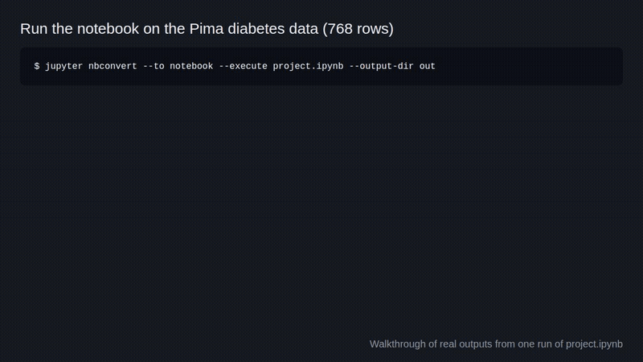

# Diabetes Prediction using Stacking



Predicts diabetes from 8 health measurements by stacking six classifiers. Code for our 2021 paper.

```
git clone https://github.com/jayhemnani9910/diabetes-prediction-stacking.git && cd diabetes-prediction-stacking && pip install -r requirements.txt && jupyter nbconvert --to notebook --execute project.ipynb --output-dir out
```

[](https://github.com/jayhemnani9910/diabetes-prediction-stacking/actions/workflows/ci.yml)

The executed notebook, with every output, is at https://jayhemnani9910.github.io/diabetes-prediction-stacking/

## Usage

The line above runs every cell and writes the executed copy to `out/project.ipynb`, leaving the committed notebook alone. It takes a few minutes, most of it in the stacking cell. To read or edit it, open `project.ipynb` in Jupyter. To check a run against the numbers below:

```
python tests/check_results.py out/project.ipynb
```

## Results

Test accuracy on the 231-row held-out set (30% of the data):

| Model | Test accuracy |
|---|---|
| Decision Tree | 75.76% |
| SVM | 74.46% |
| Gaussian NB | 74.03% |
| Random Forest | 74.03% |
| Logistic Regression | 73.59% |
| Stacking ("Our Model") | 71.43% |
| ANN | 68.40% |

Stacking did not beat the six individual models here. It comes below five of them.

The ranking is not worth much either way. With 231 test rows, one percentage point is about 2 patients, and most of these models sit within a couple of points of each other. This dataset and setup are not enough to declare a winner. The interesting part is the stacking construction, not the score.

## How it works

A stacking model has two levels. The level-0 (base) models each make a prediction, and a level-1 (meta) model learns how to combine them.

1. Load `diabetes.csv` (768 rows) and split it 70/30 with a fixed seed.
2. Zeros in Glucose, BloodPressure, SkinThickness, Insulin, BMI, DiabetesPedigreeFunction and Age are missing values, so they are filled with the training-set mean. Pregnancies is left alone, since 0 is a real value there.
3. Train six level-0 models:
   - Gaussian Naive Bayes
   - Random Forest
   - Decision Tree
   - SVM
   - ANN (scikit-learn `MLPClassifier`)
   - Logistic Regression

   All but Naive Bayes are tuned with `RandomizedSearchCV` over 10-fold CV with 3 repeats. Logistic Regression, SVM and ANN scale the features first (`StandardScaler`), since they are sensitive to scale. The tree models and Naive Bayes use the raw features.
4. Stack them with scikit-learn's `StackingClassifier`, with a Random Forest as the level-1 model and 4-fold CV.

Every model sets `random_state = 42`, so the notebook gives the same answer every time. CI runs the whole notebook on every push and checks the test accuracies above.

## Dataset

`diabetes.csv` is the Pima Indians Diabetes Database: 768 patients, all women of Pima Indian heritage aged 21 or older, with 8 measurements each and whether they showed signs of diabetes. The original owner is the National Institute of Diabetes and Digestive and Kidney Diseases. Vincent Sigillito (Johns Hopkins APL) donated it to the UCI Machine Learning Repository in 1990. UCI has since taken it down; [OpenML](https://www.openml.org/d/37) still hosts it with the original notes. The notebook's feature definitions come from a Kaggle copy. The MIT license does not cover the dataset. It was first described in:

> Smith, J.W., Everhart, J.E., Dickson, W.C., Knowler, W.C., and Johannes, R.S. (1988). Using the ADAP learning algorithm to forecast the onset of diabetes mellitus. *Proceedings of the Annual Symposium on Computer Application in Medical Care*, 261-265.

## Paper

> V. O. Khilwani, V. Gondaliya, S. Patel, J. Hemnani, B. Gandhi and S. K. Bharti, "Diabetes Prediction, using Stacking Classifier," *2021 International Conference on Artificial Intelligence and Machine Vision (AIMV)*, 2021, pp. 1-6, doi: [10.1109/AIMV53313.2021.9670920](https://doi.org/10.1109/AIMV53313.2021.9670920).

The results above come from the fixed and seeded notebook in this repo, not from the paper.

## Contributors & Authors

Vinay Khilwani, Vasu Gondaliya, Shreya Patel, Jay Hemnani & Bhuvan Gandhi

## Contributing

See [CONTRIBUTING.md](CONTRIBUTING.md). MIT licensed, see [LICENSE](LICENSE).
